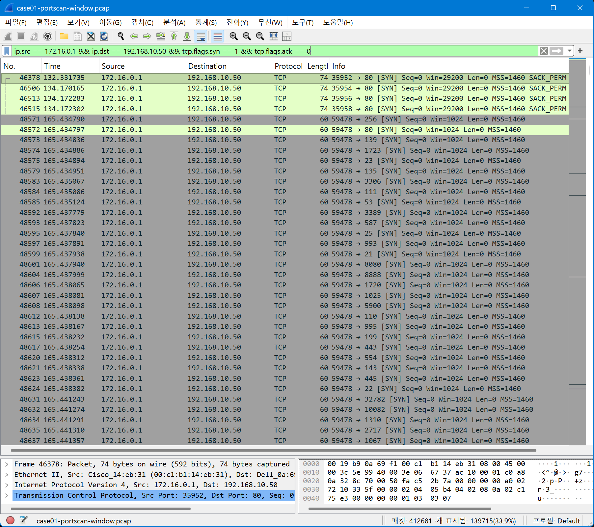

# CASE-01: TCP SYN Port Scan 분석

## Case 요약

CASE-01은 CIC-IDS2017의 `Friday-WorkingHours.pcap`에서 관찰된 TCP SYN 기반 포트 탐색 정황을 분석한 사례입니다. 전체 PCAP을 1차 집계한 뒤, 관찰된 Source `172.16.0.1`과 대상 `192.168.10.50` 사이의 SYN 패킷 및 목적지 포트 다양성을 좁혀 확인했습니다.

> 여기서 `172.16.0.1`은 PCAP상 관찰된 Source 주소입니다. NAT 또는 방화벽 구조에 따라 실제 외부 주체와 다를 수 있으므로 실제 외부 주체 주소로 단정하지 않습니다.

이 화면은 관찰된 Source `172.16.0.1`이 대상 호스트 `192.168.10.50`의 다양한 TCP 목적지 포트로 SYN을 연속 전송한 패턴을 보여줍니다. Port Scan 판단의 패킷 수준 근거이며, 서비스 버전이나 취약점 존재를 의미하지는 않습니다.

| 항목 | 내용 |
|---|---|
| Case ID | CASE-01 |
| 주제 | TCP SYN Port Scan 분석 |
| Dataset | CIC-IDS2017 |
| 원본 PCAP | `Friday-WorkingHours.pcap` |
| 분석용 PCAP | `case01-portscan-window.pcap` |
| 도구 | Wireshark, tshark, editcap |
| 관찰된 Source | `172.16.0.1` |
| 관찰된 Destination | `192.168.10.50` |
| 최종 판단 | TCP SYN / Half-open Port Scan 정찰 행위로 판단 |

## 분석 목표

- 단순 패킷 수가 많은 통신과 포트 탐색 패턴을 구분
- SYN 패킷, 목적지 포트 다양성, 응답 플래그를 연결해 판단
- 서비스 버전, 취약점 존재, 후속 침해 여부는 별도 확인 없이는 단정하지 않음

## 데이터와 분석 흐름

원본 PCAP은 약 1천만 패킷 규모였으므로 tshark로 전체 트래픽을 먼저 집계하고, 의심 시간대를 `editcap`으로 별도 PCAP으로 추출했습니다. 상세 검증은 축소한 `case01-portscan-window.pcap`에서 수행했습니다.

## 핵심 발견

- 관찰된 Source `172.16.0.1`은 SYN 패킷이 약 256,000건으로 두드러졌고, 서로 다른 TCP 목적지 포트 999개를 보였습니다.
- 해당 Source는 `192.168.10.50` 한 대를 대상으로 약 999개의 목적지 포트를 탐색한 정황을 보였습니다. 다른 주요 Destination은 대부분 Unique Port 1개 수준이었습니다.
- 한국시간 기준 `2017-07-08 02:51~02:56`에 Unique Port가 997~998개로 급증했고, 직전 구간은 약 5개 수준이었습니다.
- `192.168.10.50`에서 SYN/ACK가 확인된 열린 포트 후보는 21, 22, 80, 139, 445입니다. RST/ACK가 확인된 닫힌 포트 후보의 예는 23, 53, 111, 3306, 3389입니다.
- 22번 포트에서 `SYN → SYN/ACK → RST`가 반복되어 정상적인 3-way handshake의 마지막 ACK 없이 종료되는 TCP SYN / Half-open Scan 패턴으로 해석했습니다.

## 핵심 증거

| Evidence | 확인 내용 |
|---|---|
| [E05](evidence/screenshots/05-unique-port-ranking.png) | Source별 SYN 수와 Unique Port 비교. `172.16.0.1`이 999개로 가장 두드러짐 |
| [E06](evidence/screenshots/06-suspected-scan-target.png) | `172.16.0.1 → 192.168.10.50` 구간의 SYN 약 256,000건과 Unique Port 999개 |
| [E08](evidence/screenshots/08-minute-port-diversity.png) | 특정 분에 Unique Port 997~999개, 직전 구간 약 5개 |
| [E10](evidence/screenshots/10-syn-port-scan-pattern.png) | 짧은 시간 동안 다양한 목적지 포트로 연속 전송된 SYN 패킷 |
| [E14](evidence/screenshots/14-syn-scan-half-open-pattern.png) | 22번 포트의 `SYN → SYN/ACK → RST` 반복 |

전체 증거 파일은 [evidence/screenshots](evidence/screenshots/)에서 확인할 수 있습니다.

## MITRE ATT&CK

- **T1046 Network Service Discovery**: 포트와 네트워크 서비스를 탐색하는 행위로 매핑했습니다.

## Detection Rule 요약

동일 Source와 Destination 사이에서 TCP SYN(`SYN=1`, `ACK=0`)이 60초 이내 서로 다른 목적지 포트 100개 이상으로 관찰되면 후보 이벤트로 생성합니다. 100은 실험 기반 초기값이며, 승인된 스캐너는 allowlist로 분리하고 운영환경의 정상 트래픽에 맞춰 튜닝해야 합니다.

상세 내용은 [detection-rule.md](detection/detection-rule.md), 실제 사용 필터는 [wireshark-filters.md](detection/wireshark-filters.md)에 정리했습니다.

## 최종 판단

관찰된 트래픽은 `172.16.0.1`에서 `192.168.10.50`의 다수 TCP 목적지 포트로 SYN을 전송하고, 포트 상태에 따라 SYN/ACK 또는 RST/ACK 응답을 받은 뒤 22번 포트에서는 RST로 종료하는 패턴을 보였습니다. 따라서 **PCAP 내부에서 TCP SYN / Half-open Port Scan 정찰 행위가 관찰되었다**고 판단합니다.

이 분석만으로 실제 외부 주체 식별, 악성 의도, 서비스 버전, 취약점 존재, 후속 침해 여부는 확인하지 않았습니다. 승인된 점검 도구나 내부 자산 점검일 가능성은 별도 확인이 필요합니다.

## 상세 문서

- [상세 기술 분석](analysis.md)
- [최종 결론](conclusion.md)
- [IOC 목록](ioc.csv)
- [조사 메모](notes/investigation-notes.md)
- [Wireshark 필터 기록](detection/wireshark-filters.md)
- [탐지 규칙 설계](detection/detection-rule.md)
- [참고자료](references/sources.md)
